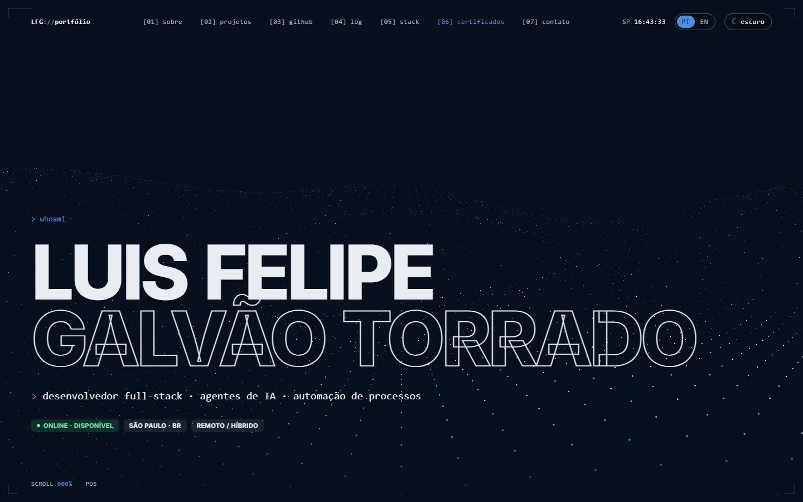
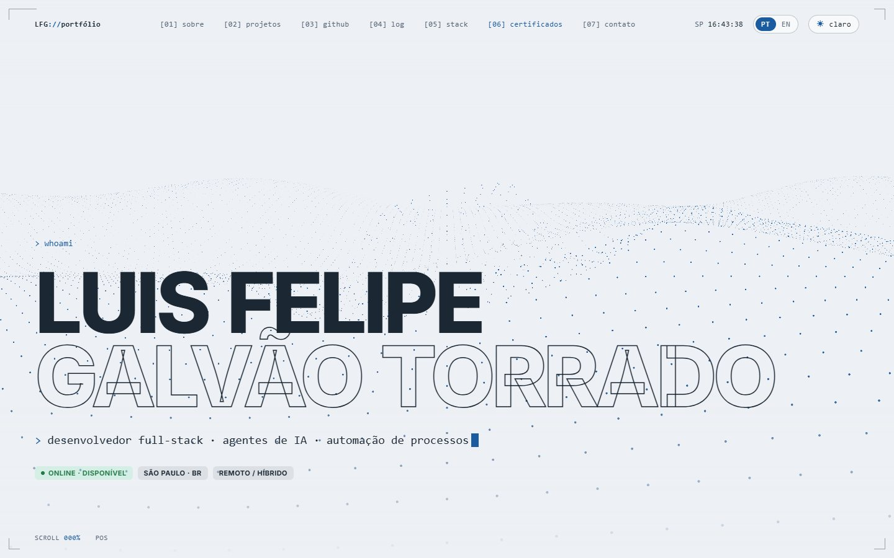
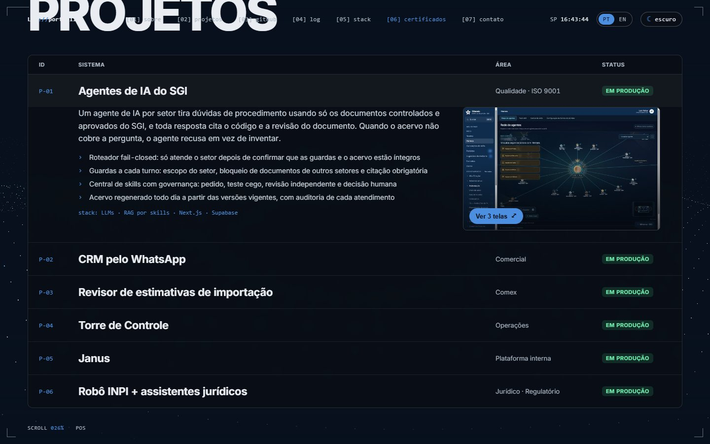
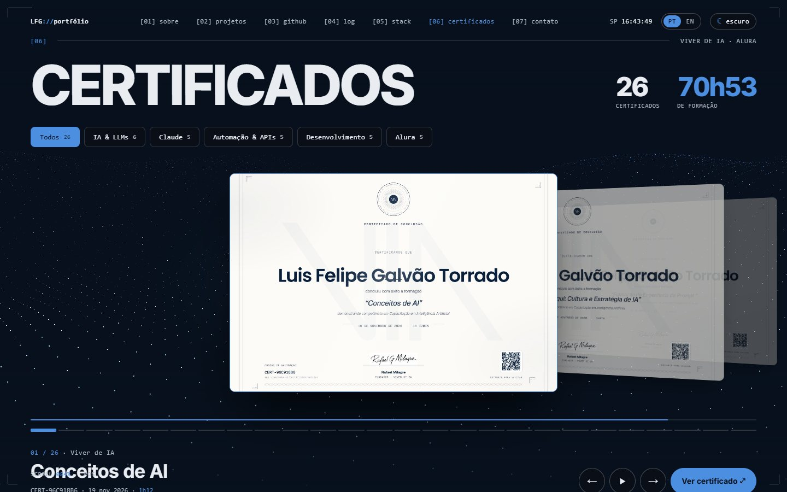
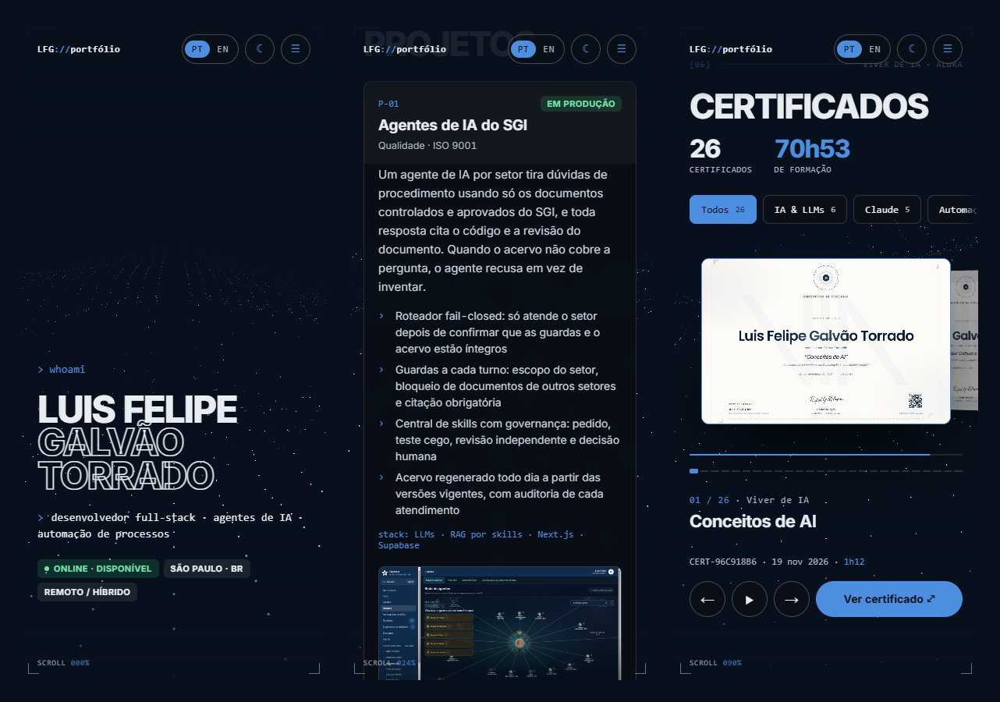

<div align="center">



# LFG://portfólio

**Luis Felipe Galvão Torrado** · desenvolvedor full-stack · agentes de IA · automação de processos

[**🌐 Ver o site**](https://sasuzin.github.io/Portfolio/) &nbsp;·&nbsp; [**🇺🇸 English version**](https://sasuzin.github.io/Portfolio/?lang=en) &nbsp;·&nbsp; [README in English](#-english)

[](https://github.com/Sasuzin/Portfolio/actions/workflows/deploy.yml)


</div>

---

## ✨ Destaques

- **Terreno 3D de partículas** em three.js com shaders GLSL próprios: as ondas reagem ao mouse e a câmera "voa" sobre o terreno conforme a rolagem.
- **Estética de terminal/HUD**: tipografia grande, títulos que se embaralham ao aparecer, texto digitado, relógio de São Paulo ao vivo e cursor personalizado.
- **Português e inglês** com um clique (botão PT/EN). A escolha fica salva, e o link `?lang=en` abre o site direto em inglês.
- **Modo claro e escuro** com transição circular (View Transitions API).
- **Projetos com galeria de telas e zoom**: pinça no celular, roda do mouse e duplo clique no computador.
- **Carrossel 3D de certificados** com autoplay, deslizar para trocar, visualizador e links de validação.
- **Totalmente responsivo**, testado de 320 px até telas grandes, com o celular em pé e deitado.
- **Acessível**: respeita `prefers-reduced-motion`, funciona pelo teclado e tem foco visível.
- **Leve no celular**: o three.js carrega sob demanda e o fundo 3D usa menos partículas em telas pequenas.
- **Deploy automático** no GitHub Pages a cada push na `main`.

## 🖼️ Telas

| Modo claro | Projetos |
| :---: | :---: |
|  |  |
| **Certificados** | **Celular** |
|  |  |

## 🧭 Seções do site

| # | Seção | O que tem |
| :-: | --- | --- |
| 01 | **Sobre** | Resumo, foto e painel `sys.info` |
| 02 | **Projetos** | Sistemas em produção, com objetivo, destaques técnicos e galeria de telas |
| 03 | **Projetos abertos** | Repositórios públicos (Owl Vault, Shonen Store, Bem Social…) com telas e links |
| 04 | **Trajetória** | Carreira em formato de `git log` |
| 05 | **Stack** | Tecnologias filtradas por área |
| 06 | **Certificados** | 26 certificados (Viver de IA e Alura) em carrossel 3D |
| 07 | **Contato** | E-mail, LinkedIn, GitHub, currículo e telefone |

## 🧱 Stack

| Camada | Tecnologias |
| --- | --- |
| Interface | React 19 · TypeScript · CSS puro (variáveis, `clamp()`, container queries) |
| 3D | three.js · shaders GLSL (`Points` + `ShaderMaterial`) |
| Animações | Web Animations API · View Transitions API |
| Build | Vite |
| Deploy | GitHub Actions → GitHub Pages |

## 🚀 Rodando localmente

Requer **Node.js 20+**.

```bash
npm install
npm run dev       # http://localhost:5173
npm run build     # checa os tipos e gera o site em dist/
npm run preview   # serve o build localmente
```

## 🗂️ Estrutura

```
├── public/
│   ├── assets/          # foto, telas dos projetos, prints dos sistemas e certificados
│   ├── certificados/    # PDFs dos certificados
│   └── uploads/         # currículo
├── src/
│   ├── components/      # seções do site, modal de galeria, zoom, nav…
│   ├── data/            # TODO o conteúdo do site, em português e inglês
│   ├── lib/             # terreno 3D, efeitos, tema e gestos
│   ├── i18n.tsx         # idiomas (PT/EN), datas e meses
│   └── styles.css
├── docs/                # imagens deste README
└── .github/workflows/   # deploy no GitHub Pages
```

## ✏️ Editando o conteúdo

Todo o texto fica em `src/data/`, sempre nos dois idiomas:

```ts
// src/data/projects.ts
{
  id: 'P-04',
  t: { pt: 'Torre de Controle', en: 'Control Tower' },
  a: { pt: 'Operações', en: 'Operations' },
  d: { pt: 'Painel único da operação…', en: 'A single operations dashboard…' },
  screens: [{ img: 'torre-dash', t: { pt: 'Visão geral', en: 'Overview' }, d: { … } }],
}
```

- **Projetos de trabalho:** `src/data/projects.ts`, com os prints em `public/assets/work/`, sempre `<nome>.jpg` + `<nome>-sm.jpg`.
- **Projetos abertos:** `src/data/repos.ts`, com as imagens em `public/assets/projects/`.
- **Certificados:** `src/data/certs.ts`, com a imagem em `public/assets/certs/` e o PDF em `public/certificados/`. O total de horas é calculado sozinho.
- **Stack:** `src/data/stack.ts`.

## 🔒 Sobre os prints de sistemas internos

Os projetos de trabalho são sistemas internos da empresa. Antes da captura, os prints tiveram borrados nomes de pessoas, clientes, marcas, valores, contagens, datas e conversas, e depois foram revisados um a um. Eles mostram só como as telas funcionam. Os textos descrevem objetivo e engenharia, sem dados do negócio.

## 🚢 Deploy

O workflow [`.github/workflows/deploy.yml`](.github/workflows/deploy.yml) roda `npm ci` e `npm run build` e publica a pasta `dist/` no GitHub Pages a cada push na `main`. O Vite usa `base: './'`, então o mesmo build funciona em `sasuzin.github.io/Portfolio/` ou em qualquer domínio próprio.

## 📫 Contato

- **E-mail:** [lfelipepassos1@gmail.com](mailto:lfelipepassos1@gmail.com)
- **LinkedIn:** [linkedin.com/in/luis-galvão](https://linkedin.com/in/luis-galvão)
- **GitHub:** [github.com/Sasuzin](https://github.com/Sasuzin)

---

## 🇺🇸 English

Personal portfolio of **Luis Felipe Galvão Torrado**, a full-stack developer from São Paulo, Brazil, working on AI agents and process automation.

**[🌐 Open the site in English](https://sasuzin.github.io/Portfolio/?lang=en)**

**Highlights**

- Interactive **3D particle terrain** built with three.js and custom GLSL shaders that reacts to the mouse and to scrolling.
- Terminal/HUD look: oversized type, scramble and typewriter effects, a live São Paulo clock and a custom cursor.
- **Portuguese and English** with a single click. The choice is remembered, and `?lang=en` links straight to English.
- **Light and dark modes** with a circular reveal (View Transitions API).
- Work projects with **screenshot galleries and zoom**: pinch, mouse wheel and double-click.
- 3D **certificate carousel** with autoplay, swipe, a viewer and verification links.
- **Fully responsive** (tested from 320 px to large screens), keyboard-friendly, and it respects `prefers-reduced-motion`.
- Automatic deploys to **GitHub Pages** on every push to `main`.

**Stack:** React 19 · TypeScript · three.js (GLSL) · Vite · GitHub Actions → GitHub Pages.

**Run it locally** (Node.js 20+):

```bash
npm install
npm run dev     # http://localhost:5173
npm run build   # type-checks and builds into dist/
```

All site content lives in `src/data/` with `{ pt, en }` fields, so both languages stay side by side.

**About the internal-system screenshots:** the work projects are internal company systems. Names, clients, trademarks, amounts, counts, dates and conversations were blurred before capture and every image was reviewed by hand. They only show how the screens work.

**Contact:** [lfelipepassos1@gmail.com](mailto:lfelipepassos1@gmail.com) · [LinkedIn](https://linkedin.com/in/luis-galvão) · [GitHub](https://github.com/Sasuzin)

---

<div align="center">
<sub>© 2026 Luis Felipe Galvão Torrado · design criado no Claude Design</sub>
</div>
